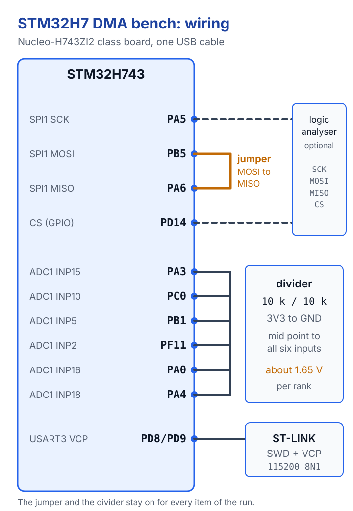
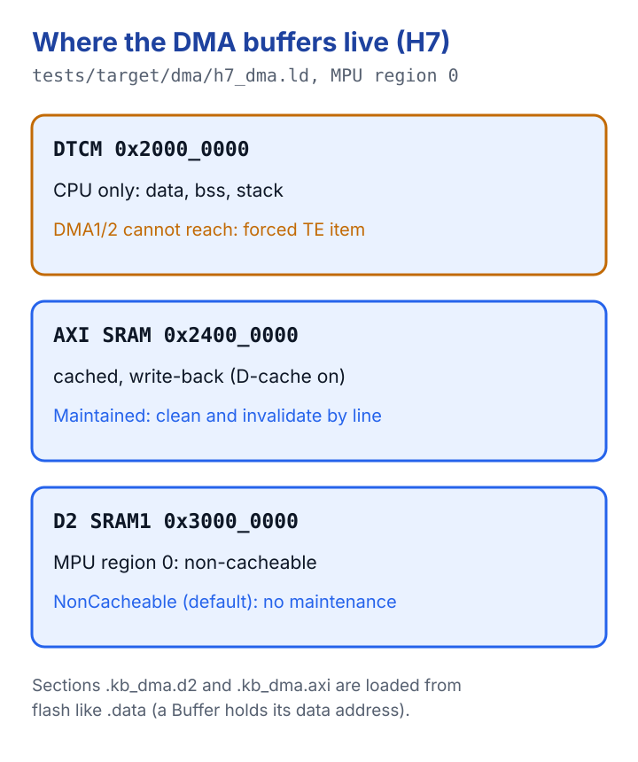

# Bench procedure: STM32H7

For a single-core STM32H7 board of the H743 class (H743, H753, H750): a Nucleo-H743ZI2 or similar with an ST-LINK
(SWD and a virtual COM port) and the pins below reachable. The dual-core parts (H745, H747, H755, H757) are refused by
the port's configure step ([Integration](../../integration.md)), so an H747 board cannot run the app until the port
supports its Cortex-M7 build.

## What is needed

| Part | Used by |
| --- | --- |
| The board, one USB cable to the ST-LINK | every item (power, SWD, console) |
| One jumper wire, PB5 (SPI1 MOSI) to PA6 (SPI1 MISO) | every `spi-*` item, `t7-en-clear`, `spi-ovr-forced`, `dma-te-dtcm` |
| Two 10 kΩ resistors as a divider from 3V3 to GND, the mid point to PA3, PC0, PB1, PF11, PA0 and PA4 | every `adc-*` item |
| A serial terminal at 115200 8N1 on the ST-LINK virtual COM port (USART3, PD8/PD9) | every item (the `KB-BENCH` lines) |
| An SWD tool (OpenOCD or STM32CubeProgrammer) | flashing |
| A logic analyser on PA5, PB5, PA6, PD14 (optional) | SCK rate and frame gaps of the `spi-*` items |

<picture>
  <source media="(prefers-color-scheme: dark)" srcset="figures/bench-h7-wiring.dark.svg">
  
</picture>

The ADC pins are analog at reset; the app does not change their mode. Keep the divider short (the six inputs share
one mid point; each reads about 1.65 V, half of VREF+).

<picture>
  <source media="(prefers-color-scheme: dark)" srcset="figures/bench-h7-memory.dark.svg">
  
</picture>

## Steps

1. **Build.** From the repository root, with the Arm GNU toolchain:

   ```bash
   cmake -S examples/stm32 -B build/h7 -G Ninja -DCMAKE_TOOLCHAIN_FILE=cmake/arm-none-eabi.cmake \
     -DKB_ARM_CORE=cortex-m7f -DEXAMPLE_BOARD=h7 -DCMAKE_BUILD_TYPE=Release
   cmake --build build/h7 --target dma_bench
   sha256sum build/h7/dma_bench.elf
   ```

   Record the image commit, the kb-core lock commit (`third_party/kb-core.lock`), the toolchain version and the hash
   in the form.
2. **Wire** as in the figure; check the jumper and the divider with a meter (PB5-PA6 continuity, about 1.65 V at the
   mid point with the board powered). Tick the wiring check in the form.
3. **Open the console** at 115200 8N1 on the virtual COM port and start logging to
   `docs/assurance/bench/runs/<yyyy-mm-dd>-<board>.log`.
4. **Flash and reset:** `openocd -f interface/stlink.cfg -f target/stm32h7x.cfg -c "program build/h7/dma_bench.elf
   verify reset exit"`.
5. **Wait for `KB-BENCH bench-end`** (about ten seconds). The app runs the items in the order of the table below,
   once. Do not touch the wiring meanwhile.
6. **Read the silicon revision** (`DBGMCU->IDCODE`, for example with `openocd ... -c "mdw 0x5C001000"`) and the clock
   tree the app ran with (`bench-start core_hz`; the app keeps the reset clock: HSI 64 MHz, SPI123 kernel clock on
   `per_ck`, the ADC on HCLK / 4).
7. **Fill the form** (`evidence-form.md`) row by row from the log; commit the form and the log together.

## Items and what each needs

| Item | What it shows | Hardware | Pass when |
| --- | --- | --- | --- |
| `spi-d2-it-8`, `spi-d2-dma-64`, `spi-d2-dma-1k` | T1/T2/T3 with staging in the D2 window (MPU non-cacheable, D-cache on): interrupt frames, DMA frames, 1 kB frames at 8 MHz | jumper | `bad=0` |
| `spi-axi-it-8`, `spi-axi-dma-64`, `spi-axi-dma-1k` | the same with staging in cached AXI SRAM: the port's clean and invalidate by line on the real cache, with speculative reads possible | jumper | `bad=0` |
| `spi-isr-cost` | interrupt cost of the receive stream (DWT), the longest confirmed stop | jumper | values recorded |
| `spi-1k-at-it-ceiling-x4` | 1 kB frames by interrupt at the ceiling the port computes | jumper | `bad=0` |
| `dma-te-dtcm` | a DMA1 stream lent DTCM memory: transfer error, the stream disables itself, the flag cleared by its own bit, no interrupt re-entry | jumper (SPI running) | `status` Fault, `te>=1`, `reentries=0` |
| `spi-ovr-forced` | the receive stream's request routed nowhere: SPI overrun, both streams stopped with proof | jumper | `BusError`, `faulted=0` |
| `t7-en-clear` | a 1 kB frame at 125 kHz stopped by a 2 ms deadline: the EN-clear latency against the port's bound | jumper | `Timeout`, `max_stop_cycles <= bound` |
| `nvic-priority-readback` | a vendor value (15) written first; the port writes its own (5) and reads it back | none | `priority=5` |
| `mpu-readback` | the D2 window without its MPU region while the D-cache is on: the start refuses | none | `NotReady` (detail 0xFC) |
| `adc-start` | the scan stream started after the HAL time base, twice (idempotent), the conversion count read back | divider | `readback=6` |
| `adc-1khz-x6-rate` | TIM6 TRGO at 1 kHz, six ranks, 2 s: rate, jitter between frame stamps, interrupt cost | divider | 1990 to 2010 frames |
| `adc-consumer-blocked` | the owner does not serve for 50 ms: overruns counted, the next frame flagged | divider | `overruns>0` |
| `adc-stall-supervision` | TIM6 stopped for 20 ms: the supervisor asks for a restart (signed stall time); frames come back with the timer | divider | `Restart`, `stalls>=1` |
| `adc-ovr-counted` | the ring's stream disabled under a running trigger: ADC overrun with OVRMOD 0, counted by the restart | divider | `hw_overruns` increased |

## When an item fails

Record the line and the log as they are. Check the wiring and the clock tree first; then open an issue with the form
attached. A failure of `spi-axi-*` with `spi-d2-*` passing points at cache maintenance; of `t7-en-clear` at the stop
bound; of `adc-1khz-x6-rate` at the trigger or the ADC clock.
