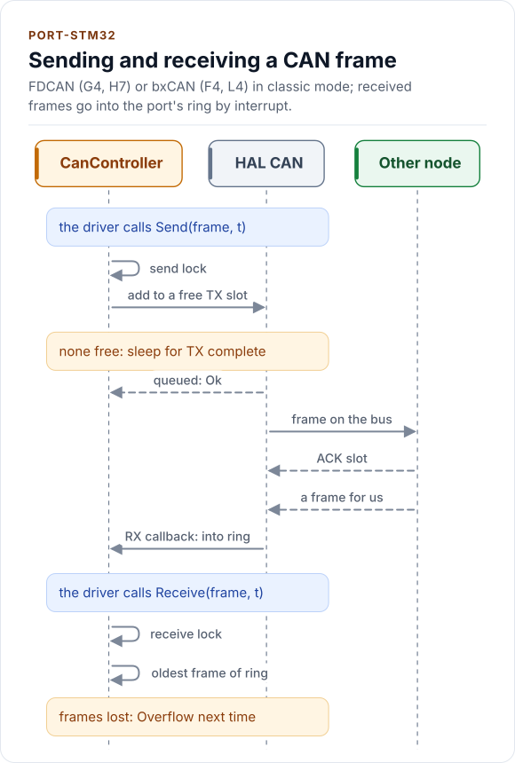

# CAN (FDCAN, bxCAN)

`kb::port::stm32::CanController` satisfies `kb::iface::CanBus`: FDCAN in classic mode on G4 and H7 (HAL
`stm32<family>xx_hal_fdcan`), bxCAN on F4 and L4 (HAL `stm32<family>xx_hal_can`). Classic CAN 2.0A/B frames;
reception by interrupt into a ring, waits on the port's clock ([How the port waits](../waits.md)).

## How it works

| Call | FDCAN (G4, H7) | bxCAN (F4, L4) |
| --- | --- | --- |
| `EnsureReady()` | The clock, TX and RX pins, `HAL_FDCAN_Init` (classic frame format, automatic retransmission, the nominal bit timing), a global filter that accepts every standard and extended frame into RX FIFO 0, the RX FIFO 0 new-message, message-lost and transmit-complete notifications on line 0, `HAL_FDCAN_Start`, `FDCANn_IT0` at `irq_priority` | The clock, the pins, `HAL_CAN_Init` (automatic bus-off management, automatic retransmission), filter bank 0 (14 for CAN2) with mask 0 into FIFO 0, the FIFO 0 message-pending, FIFO 0 overrun and mailbox-empty notifications, `HAL_CAN_Start`, `CANn_TX`, `CANn_RX0` and `CANn_SCE` at `irq_priority` |
| Receive interrupt | `HAL_FDCAN_RxFifo0Callback`: every frame of RX FIFO 0 (`HAL_FDCAN_GetRxMessage`) into the controller's ring of 32 frames; message lost latched | `HAL_CAN_RxFifo0MsgPendingCallback`: every frame of FIFO 0 into the ring; FIFO overrun (`HAL_CAN_ErrorCallback`, `HAL_CAN_ERROR_RX_FOV0`) latched |
| `Send(frame, timeout)` | A free TX FIFO element, then `HAL_FDCAN_AddMessageToTxFifoQ`; with none free, waits for the transmit-complete interrupt | A free mailbox, then `HAL_CAN_AddTxMessage`; with none free, waits for a mailbox-complete interrupt |
| `Receive(frame, timeout)` | The oldest frame of the ring; with none, waits for the receive interrupt | The same |
| `Status()` | `HAL_FDCAN_GetProtocolStatus`, `HAL_FDCAN_GetErrorCounters` | The ESR register: TEC, REC, LEC, BOFF |
| `Recover(timeout)` | When bus-off: `HAL_FDCAN_Stop`, `HAL_FDCAN_Start` (leaving INIT starts the recovery of 128 x 11 recessive bits), then waits | When bus-off: waits; the hardware recovers by itself |
| `Release()` | `HAL_FDCAN_Stop`, `HAL_FDCAN_DeInit` | `HAL_CAN_Stop`, `HAL_CAN_DeInit` |

<!-- figure: can-send-receive -->
<picture>
  <source media="(prefers-color-scheme: dark)" srcset="../diagrams/can-send-receive.dark.svg">
  
</picture>
<!-- /figure -->

Modes (`CanConfig::mode`): `Normal`, `Loopback` (internal: frames sent are received, the bus is not driven) and
`ListenOnly` (bus monitoring / silent).

## Bit timing

`ComputeCanTiming()` takes the kernel clock and the bit rate and picks the most time quanta per bit (8 to 25) that
divide the clock exactly with a prescaler in range, with the sample point nearest 87.5 % (CiA 301) and SJW equal to
phase segment 2 (at most the controller's limit).

| | Prescaler | Seg 1 | Seg 2 | SJW |
| --- | --- | --- | --- | --- |
| FDCAN nominal | 1 to 512 | 1 to 256 | 1 to 128 | 1 to 128 |
| bxCAN | 1 to 1024 | 1 to 16 | 1 to 8 | 1 to 4 |

A bit rate the clock cannot make exactly (for example 500 kbit/s from 41 MHz) is `InvalidArgument`; choose a kernel
clock that is a multiple of the bit rate (40, 80, 160 MHz on FDCAN; 42 or 45 MHz APB1 on F4). `Timing()` returns the
fields in use.

## Pins and clock

| Item | Note |
| --- | --- |
| TX, RX | `PinId` with the CAN alternate function (AF9 for FDCAN1 and CAN1 on PA11/PA12 and PB8/PB9 on most parts); RX with pull-up. A transceiver (for example a 3.3 V TCAN or SN65HVD part) is needed on the bus |
| Kernel clock | `kernel_clock_hz`, or 0: `HAL_RCCEx_GetPeriphCLKFreq(RCC_PERIPHCLK_FDCAN)` on G4 and H7, PCLK1 on F4 and L4 |
| Bit rate | 10 kbit/s to 1 Mbit/s |

## Timing limits

| Wait | Bound |
| --- | --- |
| The send and the receive locks | `lock_timeout` each (default 10 ms, at most 2 s) |
| `Send` | Its timeout (at most 2 s) for a free slot; a bus-off controller ends the wait at once with `BusError` |
| `Receive` | Its timeout (at most 2 s) for a frame |
| `Recover` | Its timeout (at most 2 s) for the controller to leave bus-off, checked after each bounded pause (the send lock is held for the whole wait) |

`Send` and `Receive` have separate locks: a `Receive()` that waits does not hold off a `Send()` from another task.

## Losses

RX FIFO 0 holds 3 frames on G4 FDCAN and on bxCAN (16 as the port configures it on H7). The receive interrupt
empties it into the controller's ring of `kCanRxFrames` (32) at once, so a burst is not lost while the receiving
task is busy. A FIFO overrun (`can_flags::kFifoOverrun`) or a full ring (`can_flags::kRingFull`) is latched and the
next `Receive()` returns `Overflow` with the flags in `Detail()`; the frames already in the ring stay for the
receives that follow.

## Results

| Result | When |
| --- | --- |
| `Ok` | Queued (`Send`), taken (`Receive`), on the bus (`Recover`) |
| `Timeout` | No free slot, no frame, or still bus-off within the timeout |
| `Overflow` | `Receive`: frames were lost since the last `Receive` (Detail: `can_flags`) |
| `BusError` | `Send` on a bus-off controller, or the HAL refused the frame (Detail: `HAL_FDCAN_ERROR_*` / `HAL_CAN_ERROR_*`) |
| `InvalidArgument` | dlc above 8, an identifier wider than 11 or 29 bits, a bit rate the clock cannot make, bad pins, a timeout above 2 s |
| `Unsupported` | The device has no controller of this number |
| `Busy` | The lock was not had in time; or the controller is owned by another object |
| `Fault` | Another HAL refusal |
| `NotReady` | Before `EnsureReady()`; or the kernel clock reads 0 Hz, or the HAL time base does not run |

`Status()` gives the state (`ErrorActive`, `ErrorPassive` with a counter at 128 or above, `BusOff`), TEC, REC and
the last error code.
